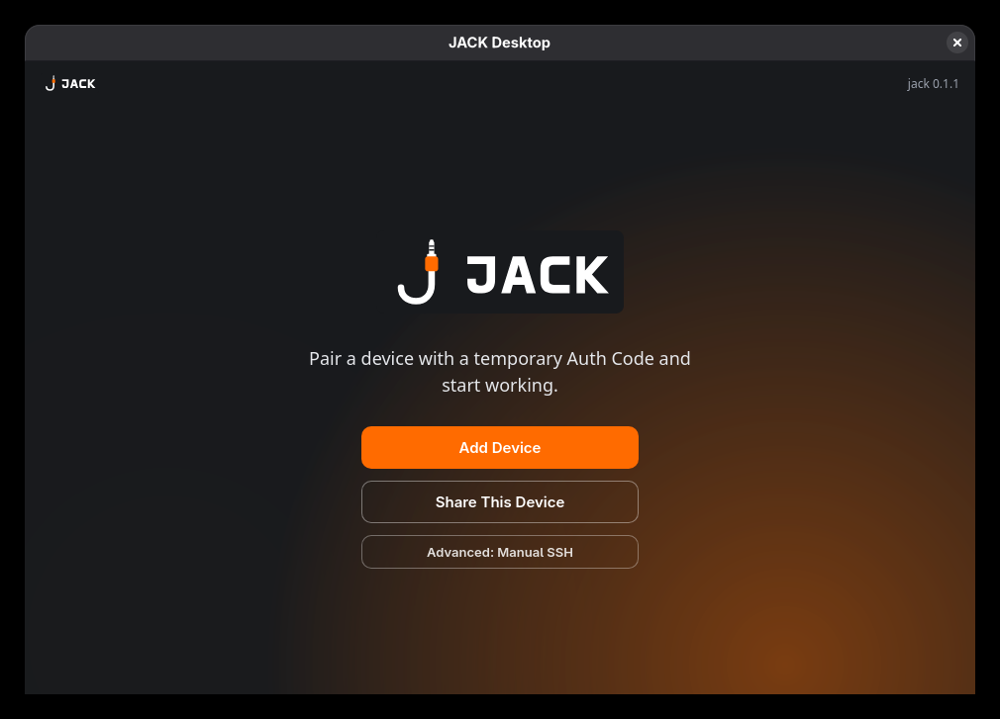
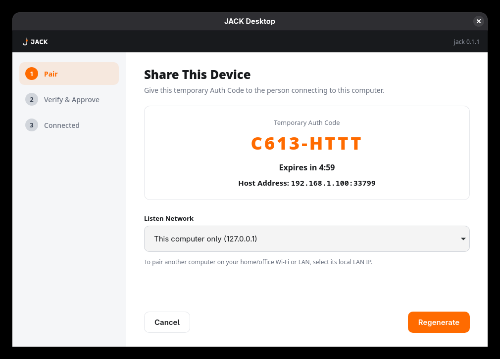
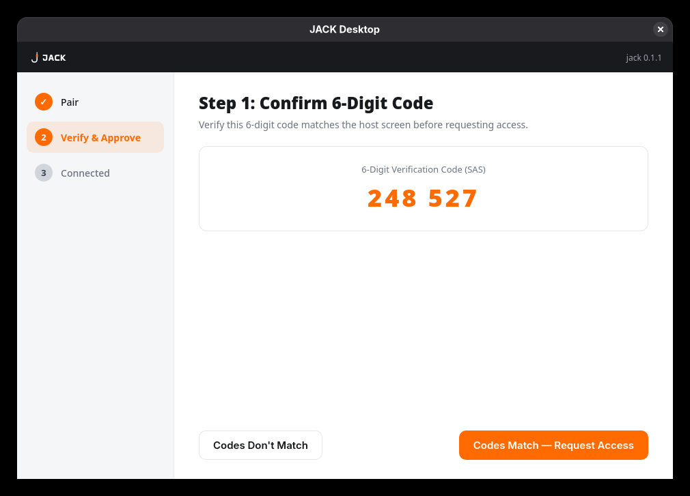
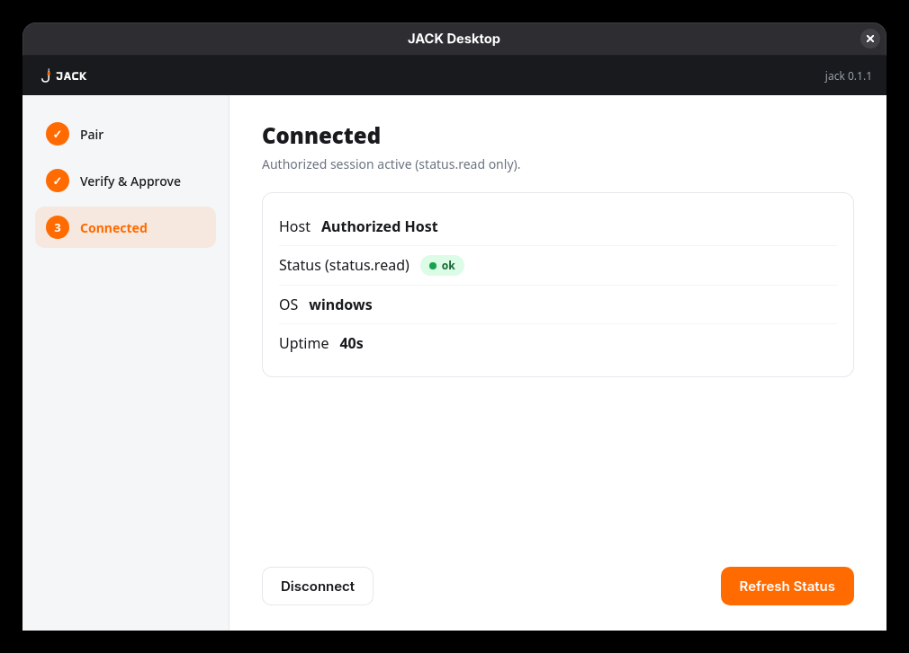
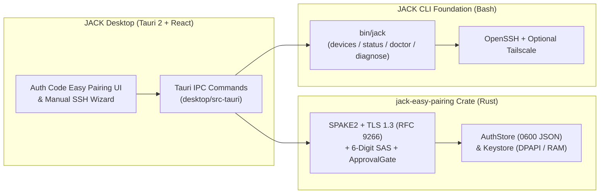

# JACK — Just Connect.


**JACK** is a fast, verifiable, least-privilege device connectivity toolkit for developers, lab operators, and multi-OS workstation users working across **Linux**, **macOS**, and **Windows 11**.

- **Latest Stable CLI Release**: [`v0.1.1`](https://github.com/mmontielpz/jack/releases/tag/v0.1.1) ([release notes](docs/release-notes-0.1.1.md)) · First Stable Release: [`v0.1.0`](https://github.com/mmontielpz/jack/releases/tag/v0.1.0) ([release notes](docs/release-notes-0.1.0.md))
- **Current Milestone on `main` & `develop`**: **`v0.2.0-rc.1` Experimental Release Candidate** ([RC notes](docs/release-notes-0.2.0-rc.1.md) · [Engineering Case Study](docs/ENGINEERING-CASE-STUDY.md))
- **License**: [MIT](LICENSE)

---

## Why JACK Exists — Two Complementary Layers

Connecting to your own machines across Linux, macOS, and Windows usually forces an awkward choice between manual SSH key wrangling or heavyweight cloud-managed remote desktop agents. JACK separates device connectivity into two explicit, auditable layers:

| Layer | Status in `v0.2.0-rc.1` | Primary Use Case | Security & Scope Boundary |
|---|---|---|---|
| **1. JACK Desktop + Easy Pairing** (`desktop/` + `easy-pairing/`, bundle `0.1.0`) | **Experimental Preview** | Pair two local or LAN devices in seconds using a short-lived 8-character code (`XXXX-XXXX`) with zero SSH key or username setup. | **Read-only `status.read` only** (`This session` only). Uses SPAKE2 + TLS 1.3 (`RFC 9266` exporter binding) + 6-digit SAS comparison + explicit Host human approval (`Approve`/`Deny`) + instant revocation. **Never grants a remote shell or file access.** |
| **2. JACK CLI** (`bin/jack`, version constant `0.1.1`) | **Stable Foundation** (`v0.2.0` device registry active on `main`) | Register, diagnose, and open interactive OpenSSH sessions to named devices (`jack add`, `jack connect`, `jack devices`, `jack status`, `jack doctor`, `jack diagnose`). | Zero background daemon. Delegates transport and authentication to your existing **OpenSSH** and optional **Tailscale** installation. Never stores passwords or private keys. |

> **Truthful Scope Disclosure**:
> - Easy Pairing is an **experimental `status.read`-only preview** and has **not** undergone an independent third-party cryptographic audit ([`ADR-009`](docs/product/easy-pairing/ADR.md)).
> - On Windows, device keys use per-user DPAPI (`CryptProtectData`); on Linux and macOS, V0.2 preview builds keep ephemeral device identities in memory for the active session (`InMemoryTestKeystore`) and never write plaintext private keys to disk (`TD-004`).
> - macOS ARM64 `.dmg` bundles are ad-hoc bundle-signed (`flags=0x2(adhoc)`, verified with `codesign --verify --deep --strict`), not Apple Developer ID notarized; Windows NSIS installers are unsigned previews (`TD-005`).
> - Future cross-device agent workflows are roadmap items scheduled *after* V0.2 family dogfood acceptance (`015`) and are not part of V0.2 ([`docs/ROADMAP.md`](docs/ROADMAP.md)).

---

## Verified Runtime Demonstration (JACK Desktop Easy Pairing)

The captures below are genuine runtime screenshots from qualified `v0.2.0-rc.1` builds running on CachyOS Linux and paired against a Windows 11 KVM guest (`scripts/dogfood/`):

| 1. Auth Code-First Home | 2. Host: Share This Device (`XXXX-XXXX`) |
|---|---|
|  |  |
| **3. Client: Confirm 6-Digit SAS Code** | **4. Connected (`status.read` Active Session)** |
|  |  |

### How the 4-Step Easy Pairing Flow Works
1. **Share (`Host`)**: Click **Share This Device**. JACK binds to `127.0.0.1` by default (or an explicitly selected RFC1918 LAN / virtual bridge / CGNAT interface; public and wildcard `0.0.0.0` addresses are rejected) and generates a single-use 8-character Crockford Base32 code (`XXXX-XXXX`, 300s TTL, max 5 attempts).
2. **Enter Code (`Client`)**: Click **Add Device**, enter the Host `IP:port` and 8-character Auth Code. Both peers run a TLS 1.3 handshake (`rustls` Ed25519 certificates) and a SPAKE2 password-authenticated key exchange bound to the TLS 1.3 session via `RFC 9266` (`EXPORTER-Channel-Binding`).
3. **Verify 6-Digit SAS & Approve (`Client` + `Host`)**: Both devices independently derive a 6-digit Short Authentication String (`SAS`) via HKDF-SHA256. After the Client confirms the SAS matches, the Host displays an explicit **Approve / Deny** prompt showing the requesting device, SAS, scope (`status.read`), and duration (`This session only`).
4. **Connected & Instant Revocation**: Only after protocol-confirmed Host approval do both screens transition to **Peer Authorized** (`Host`) and **Connected** (`Client`). Either side can disconnect or click **Revoke Access** at any time; the Client reconciles session state every 2.5 seconds and fails closed on revocation or disconnect.

---

## Platform Compatibility & Qualification Matrix (`v0.2.0-rc.1`)

JACK strictly distinguishes **CI build/smoke**, **KVM VM E2E**, and **physical hardware E2E** ([full evidence in `docs/release-notes-0.2.0-rc.1.md`](docs/release-notes-0.2.0-rc.1.md)):

| Platform | CLI (`bin/jack`) | Desktop Preview (`0.1.0`) | CI Build & Smoke | Cross-Machine Native GUI E2E | Signing & Keystore Notes |
|---|---|---|---|---|---|
| **Arch Linux / CachyOS (`x86_64`)** | **Supported** | **Experimental RC** (`.AppImage`) | **PASS** (Local + CI suite) | **PASS** (Bidirectional `Linux <-> Win11 KVM VM` & `Physical macOS -> Linux`) | Ephemeral RAM keystore (`TD-004`); LAN Host requires explicit firewall rule if `ufw` is active (`TD-006`) |
| **Ubuntu 24.04 LTS (`x86_64`, incl. WSL2)** | **Supported** | **Experimental RC** (`.AppImage`, `.deb`) | **PASS** (`ubuntu-24.04` CLI + `xvfb-run` Desktop smoke) | **DEFERRED (`015`)** (Evaluated via headless CI `xvfb-run`; physical desktop GUI deferred) | Built against glibc 2.39; ephemeral RAM keystore |
| **Ubuntu 26.04 LTS (`x86_64`)** | **Experimental RC** | **Experimental RC** (`.AppImage`, `.deb`) | **PASS** (`ubuntu-26.04` CLI + `xvfb-run` verification of 24.04 bundle) | **DEFERRED (`015`)** (Headless CI `xvfb-run` verified) | Uses `ubuntu-24.04`-built bundle for glibc compatibility |
| **macOS 15.7.7 (`arm64` Apple Silicon)** | **Deferred for v0.2** (`v0.1.0`/`v0.1.1` tags available) | **Experimental RC** (`JACK Desktop_0.1.0_arm64.dmg`) | **PASS** (`macos-15` DMG build, `codesign --verify --deep --strict`, startup smoke) | **PARTIAL** (Physical M-series Mac `Host -> Linux Client` **PASS**; `Linux -> macOS` deferred to `015`) | Ad-hoc bundle-signed (`flags=0x2(adhoc)`), **not** Apple notarized (`System Settings → Privacy & Security → Open Anyway`) |
| **Windows 11 (`x86_64`)** | **SSH Target Only** (or via WSL2 Ubuntu) | **Experimental RC** (`JACK Desktop_0.1.0_x64-setup.exe`) | **PASS** (`windows-latest` NSIS install, cold `26.8 MiB` / warm `29.8 MiB`, uninstall smoke) | **PARTIAL** (Bidirectional `Linux <-> Win11` KVM VM **PASS**; physical Windows 11 hardware deferred to `015`) | Persistent per-user Windows DPAPI keystore; unsigned NSIS preview installer |
| **macOS Intel (`x86_64`)** | **Unqualified** | **Unqualified** (Manual `workflow_dispatch` only) | Manual build only | **NOT_TESTED** | Excluded from default PR CI matrix |

### Version Reconciliation (`v0.2.0-rc.1` vs `0.1.1` vs `0.1.0`)
During the V0.2 release-candidate campaign, three version identifiers coexist intentionally ([details in `docs/releases.md`](docs/releases.md#v02-release-candidate-version-reconciliation--policy-proposal-011-g4)):
- **Repository Milestone**: `0.2.0-rc.1`
- **CLI Authoritative Constant (`bin/jack`)**: `JACK_VERSION='0.1.1'` (preserved so deterministic offline CLI contract tests in `./scripts/dev-check.sh` remain invariant until an owner-authorized tag bump)
- **Desktop & Easy Pairing Preview Bundles (`desktop/`, `easy-pairing/`)**: `0.1.0` (`JACK Desktop_0.1.0_amd64.AppImage`, `JACK Desktop_0.1.0_amd64.deb`, `JACK Desktop_0.1.0_arm64.dmg`, `JACK Desktop_0.1.0_x64-setup.exe`)

---

## Quick Start

### Option A — JACK CLI (`bin/jack` on Arch/CachyOS & Ubuntu Linux)

Install Bash, Git, and an OpenSSH client (`pacman -S bash git openssh` or `sudo apt install bash git openssh-client`), and optionally Tailscale if connecting over a tailnet.

```bash
# 1. Clone and install user-level symlink (~/.local/bin/jack)
git clone https://github.com/mmontielpz/jack
cd jack
./scripts/setup-workstation.sh
export PATH="$HOME/.local/bin:$PATH"

# 2. Verify CLI and prerequisites
jack --version
jack doctor

# 3. Register a device (direct SSH or Tailscale) and set default
jack add lab                  # interactive preview + confirmation
# or non-interactive: jack add lab --non-interactive --yes --user <user> --host <host>
jack devices
jack default lab --yes

# 4. Check status and connect
jack status lab
jack                          # connects to default device (or: jack connect lab)

# 5. Uninstall only the CLI symlink (preserves config, keys, known_hosts, backups)
jack uninstall
```

Keep the checkout in place while installed: `~/.local/bin/jack` is a symlink to `bin/jack`. Installers require explicit `yes` consent before creating or removing the symlink and never modify packages, services, `~/.config/jack/config`, or `~/.ssh/known_hosts`.

### Option B — Building & Running JACK Desktop + Easy Pairing From Source

See [`desktop/README.md`](desktop/README.md) and [`CONTRIBUTING.md`](CONTRIBUTING.md) for platform prerequisites (`webkit2gtk-4.1` on Linux, Xcode Command Line Tools on macOS, MSVC + WebView2 on Windows 11).

```bash
# 1. Run Easy Pairing Rust cryptographic & protocol test suite (12 tests)
cargo test --manifest-path easy-pairing/Cargo.toml

# 2. Run Tauri backend unit & IPC integration tests (7 tests)
cargo test --manifest-path desktop/src-tauri/Cargo.toml

# 3. Install frontend dependencies, lint, build, and run Vitest suite (12 tests)
npm --prefix desktop ci
npm --prefix desktop run lint
npm --prefix desktop run build
npm --prefix desktop test -- --run

# 4. Build native desktop bundle for your current OS
cd desktop && npx tauri build
```

---

## Architecture Overview



---

## Documentation Navigation

### Getting Started & User Guides
- **[User Guide (`docs/guide.md`)](docs/guide.md)**: CLI prerequisites, `PATH` setup, interactive/automated configuration, discovery limits, diagnosis, upgrade, and safe uninstall.
- **[Desktop Guide (`desktop/README.md`)](desktop/README.md)**: Building, testing, packaging, resetting config, and uninstalling JACK Desktop.

### Engineering, Architecture & Security
- **[Engineering Case Study (`docs/ENGINEERING-CASE-STUDY.md`)](docs/ENGINEERING-CASE-STUDY.md)**: End-to-end technical deep dive into JACK's product evolution, SPAKE2 + TLS 1.3 channel binding, cross-OS qualification, `012A` performance audit measurements, and technical debt backlog.
- **[Easy Pairing Architecture Decision Records (`docs/product/easy-pairing/ADR.md`)](docs/product/easy-pairing/ADR.md)**: `ADR-001` through `ADR-012`.
- **[Pairing Protocol Specification (`docs/product/easy-pairing/PAIRING_PROTOCOL.md`)](docs/product/easy-pairing/PAIRING_PROTOCOL.md)** & **[Threat Model (`docs/product/easy-pairing/THREAT_MODEL.md`)](docs/product/easy-pairing/THREAT_MODEL.md)**: 26-threat matrix, wire frames, HKDF labels, and state transitions.
- **[Autonomous Dogfood Privilege Boundary (`docs/JACK-VM-GRANT-001.md`)](docs/JACK-VM-GRANT-001.md)**: HMAC-SHA256 signed capability grants for local VM testing.
- **[Security Policy (`SECURITY.md`)](SECURITY.md)**: Trust boundaries and GitHub private vulnerability reporting.

### Roadmap, Releases & Community
- **[Product Roadmap & Support Policy (`docs/ROADMAP.md`)](docs/ROADMAP.md)**: V0.2 Experimental RC $\rightarrow$ V0.3 (OS keystores, Developer ID/notarization, mDNS/QR, `workspace.read`) $\rightarrow$ V1.0 (external crypto audit, cross-NAT relay, 3-OS physical certification).
- **[Release & Version Policy (`docs/releases.md`)](docs/releases.md)** · **[`v0.2.0-rc.1` Notes](docs/release-notes-0.2.0-rc.1.md)** · **[`v0.1.1` Notes](docs/release-notes-0.1.1.md)** · **[`v0.1.0` Notes](docs/release-notes-0.1.0.md)** · **[Campaign 009 Readiness](docs/release-readiness-009.md)**
- **[Contributing Guide (`CONTRIBUTING.md`)](CONTRIBUTING.md)** · **[Code of Conduct (`CODE_OF_CONDUCT.md`)](CODE_OF_CONDUCT.md)** · **[Brand Guidelines (`docs/branding.md`)](docs/branding.md)**

---

## License

JACK is open source under the [MIT License](LICENSE).
