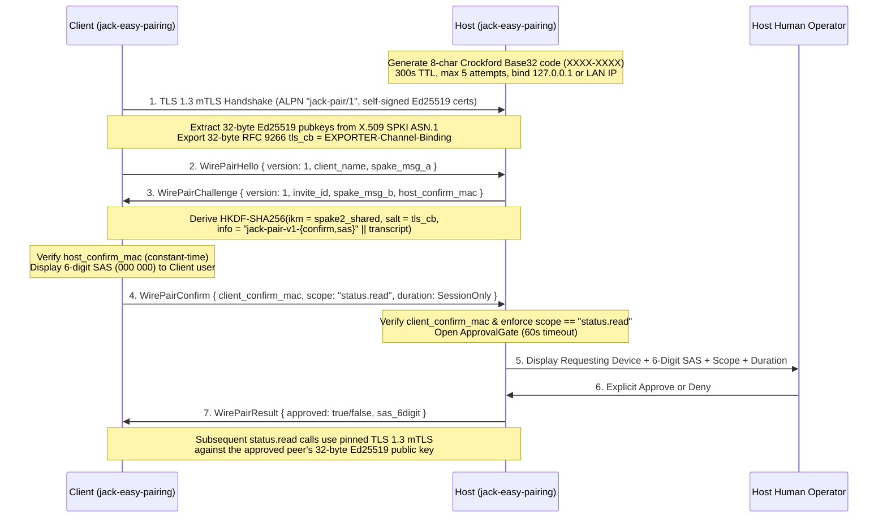

# JACK Engineering Case Study: From Zero-Daemon SSH CLI to Channel-Bound Cross-Platform Device Pairing

> **Milestone**: `v0.2.0-rc.1` (`EXPERIMENTAL_RC` · Qualified Git Tree `c0d7cc33df0b7ca2d0da0c22f3d1a028d1bbb0da`)  
> **Scope**: Evidence-backed systems engineering, cryptographic protocol composition, cross-OS qualification, and quantitative performance baseline (`012A`).

---

## 1. Problem & User Need

Developers and researchers who work across hybrid **Linux**, **macOS (Apple Silicon)**, and **Windows 11** workstations or local VMs face two distinct connectivity needs:

1. **Full Terminal Access (`bin/jack` CLI)**: When an operator already has OpenSSH and optional Tailscale configured, they want a zero-daemon, deterministic CLI to register named devices (`jack add`), verify reachability and prerequisites (`jack status`, `jack doctor --json`, `jack diagnose --json`), and open an SSH session (`jack connect`).
2. **Zero-Setup Local/LAN Pairing (`desktop/` + `easy-pairing/`)**: When two machines on the same desk, LAN, or virtual bridge have not exchanged SSH keys or usernames, setting up `sshd`, editing `~/.ssh/authorized_keys`, and verifying host fingerprints just to check peer health is high-friction. Conversely, granting unrestricted remote shell access via a short pairing code would violate least privilege.

**JACK's Design Principle**: Pair two devices in under 30 seconds using a short-lived 8-character code (`XXXX-XXXX`), cryptographic channel binding, 6-digit SAS verification, and explicit Host human approval — while strictly limiting the granted capability to read-only `status.read` for the active session (`This session` only).

---

## 2. Product & Architectural Evolution (`v0.1.0` → `v0.1.1` → `v0.2.0-rc.1`)

| Milestone | Key Deliverables | Architectural Invariants Established |
|---|---|---|
| **`v0.1.0`** ([notes](release-notes-0.1.0.md)) | Initial zero-daemon Bash CLI (`bin/jack`) for `workstation` and `mac` destinations over Tailscale + OpenSSH. | Literal `KEY=VALUE` config parsing (never `source`d), consented `~/.local/bin/jack` symlink installer, strict argument validation. |
| **`v0.1.1`** ([notes](release-notes-0.1.1.md)) | Governed lifecycle CLI (`jack install`, `jack uninstall`, offline `jack update` planner) and consent-window race protection. | Symlink-only uninstall preserving `~/.config/jack/config` and `~/.ssh/known_hosts`; zero automatic git fetch or filter execution. |
| **`v0.2.0` CLI (on `main`)** | Multi-device registry (`jack add <alias>`, `jack devices --json`, `jack default <alias>`, `jack status [alias] --json`), Ubuntu & WSL2 support. | Machine-readable JSON schemas (`jack-devices/1`, `doctor`, `diagnose`) and read-only default repair refusal. |
| **`v0.2.0-rc.1` Desktop + Easy Pairing** ([notes](release-notes-0.2.0-rc.1.md)) | Native Tauri 2 + React 18 + Rust desktop app (`desktop/`) and `jack-easy-pairing` crate (`easy-pairing/`). | Auth Code-first Home, SPAKE2 + TLS 1.3 `RFC 9266` exporter binding, 6-digit SAS, Host `ApprovalGate`, Windows DPAPI keystore, and `JACK-VM-GRANT-001` dogfood boundary. |

---

## 3. Cryptographic & Authorization Architecture (`easy-pairing/`)

> **Audit Status (`ADR-009`)**: `jack-easy-pairing` composes standard, peer-reviewed Rust cryptographic crates (`rustls`, `spake2`, `hkdf`, `hmac`, `sha2`, `ed25519-dalek`, `rcgen`, `x509-parser`, `subtle`, `zeroize`), but **no independent third-party cryptographic audit has been performed yet**.

### 3.1 Protocol Handshake & Channel Binding (`PAIRING_PROTOCOL.md`)

### 3.2 Key Security Invariants
1. **MITM Resistance via `RFC 9266` Exporter Binding**: An active attacker who intercepts the TLS connection cannot relay the SPAKE2 exchange across two separate TLS sessions because both peers mix the 32-byte `EXPORTER-Channel-Binding` value (`tls_cb`) and both Ed25519 public keys (`host_pk`, `client_pk`) into the HKDF salt and `jack-pair-v1` transcript (`easy-pairing/src/pairing.rs:370-423`).
2. **Pre-Approval Scope Gate**: `host_handle_pairing_connection` (`easy-pairing/src/lib.rs:186`) validates `CapabilityScope::parse(&confirm.requested_scope)` *before* opening `ApprovalGate`, ensuring an unapproved scope request never reaches the human prompt.
3. **Protocol-Confirmed UI Transitions (`008`)**: Neither the Host nor the Client displays an authorized/connected state on button click alone; the Host transitions through `Authorizing Device...` (`Step 2`) and renders the `Peer Authorized` (`role="status"`) card only after `AuthStore::approve_and_persist` and TLS confirmation complete.
4. **Instant Revocation & Bounded Client Reconciliation (`005` / `008`)**: Clicking **Revoke Access** on the Host marks the peer and grant revoked in `AuthStore` (`0600` atomic write) and sets `revoked_flag` on active sessions; the Client runs a 2.5-second `status.read` reconciliation loop with an in-flight guard (`desktop/src/App.tsx:732-769`) that immediately transitions out of `Connected` if the Host revokes access or stops sharing.

---

## 4. Cross-Platform Systems Engineering Challenges & Solutions

| Challenge | Root Cause Discovered | Engineering Solution Implemented |
|---|---|---|
| **1. Linux Virtual Bridge (`virbr0`) Missing from `Listen Network` (`005`)** | Standard UDP route-probing (`connect("192.168.255.254:80")`) resolves only the default egress interface (`enp39s0`), omitting local KVM/container bridge IPs (`192.168.122.1`). | Added `/proc/net/fib_trie` parser (`parse_linux_fib_trie_local_ips` in `easy-pairing/src/transport.rs:70-87`) extracting `/32 host LOCAL` addresses filtered through `is_lan_or_loopback_ip()`, keeping `127.0.0.1` as default and rejecting public IPs (`ADR-012`). |
| **2. Windows 11 Startup Stall When `bin/jack` Bash CLI Is Absent (`003`)** | Synchronous CLI preflight on app boot failed on native Windows 11 where `/usr/bin/env bash` is not installed. | Made background CLI metadata loading non-blocking (`Promise.allSettled` in `desktop/src/App.tsx:446-450`), moved CLI subprocess calls to `tauri::async_runtime::spawn_blocking`, and added `CREATE_NO_WINDOW` (`0x08000000`) to prevent console flashes. |
| **3. macOS Sequoia Gatekeeper "Damaged App" Dialog under Quarantine (`007B`)** | Rust's `aarch64-apple-darwin` linker produces a `linker-signed` Mach-O executable, leaving `JACK Desktop.app/Contents/_CodeSignature/CodeResources` absent; macOS Sequoia rejects unsealed bundles under `com.apple.quarantine`. | Enforced `codesign --force --deep --sign - "JACK Desktop.app"` (`flags=0x2(adhoc)`, `Sealed Resources version=2`) followed by `codesign --verify --deep --strict` both before `hdiutil create` and after mounting the built `.dmg` in CI (`ADR-010`). |
| **4. Least-Privilege Cross-OS VM Dogfooding (`006`)** | Allowing `Linux Host <- Windows 11 KVM Guest` connections over `virbr0` required a temporary host `ufw` rule without granting the test runner unrestricted `sudo`. | Created `JACK-VM-GRANT-001` (`docs/JACK-VM-GRANT-001.md`): an HMAC-SHA256 signed, time-bounded, non-replayable, revocable capability token verified by a fixed-operation helper (`jack-dogfood-net-helper`, `ADR-011`). |

---

## 5. CI, Reproducibility & Single-Commit Artifact Provenance (`010B` / `011` / `011B`)

Every release candidate artifact for `v0.2.0-rc.1` was built from the single qualified commit `94b590d851e9505200aa9256eb24ec3a3ffedd07` (Git tree `c0d7cc33df0b7ca2d0da0c22f3d1a028d1bbb0da`, identical across `main` `01a6b1b11c9907b297094d552af52dfaeba31009` and `develop` `7a5cb6a8abd21ffafb6250f60c7bf02d8e60682f`) with all third-party GitHub Actions pinned to full 40-character commit SHAs:

| Platform / Runner | Artifact Filename | Size | Verified SHA-256 Checksum (`94b590d8`) | CI Smoke & Verification |
|---|---|---:|---|---|
| **Linux (`ubuntu-24.04` GLIBC 2.39)** | `JACK Desktop_0.1.0_amd64.AppImage` | `79.07 MiB` | `a34826b40f5fdc369d1305869498b1b4777d7e6ca94c209f9a6ad5e270ad61ed` | `xvfb-run` startup smoke PASS on `ubuntu-24.04` & `ubuntu-26.04` |
| **Linux (`ubuntu-24.04` GLIBC 2.39)** | `JACK Desktop_0.1.0_amd64.deb` | `4.19 MiB` | `7021e04ca6fb3c7d5ed29fa70bcc167bc35dc682cc149282e9cbeb75a7d702c8` | `dpkg-deb` metadata + `xvfb-run` smoke PASS on `ubuntu-24.04` & `ubuntu-26.04` |
| **Windows 11 (`windows-latest` 10.0.26100.0)** | `JACK Desktop_0.1.0_x64-setup.exe` | `2.75 MiB` | `d0e1b4a1db32bf2504b4d69401468340abc98e12cbc43e5cb40ccc7f59c6dd62` | NSIS silent install, cold (`26.8 MiB`) & warm (`29.8 MiB`) launch, uninstall PASS |
| **Windows 11 Portable Binary** | `jack-desktop.exe` | `11.23 MiB` | `2475a6bf755455bf8beab0567810bf4cf2eb6105da5a24d5f9836dd946878007` | PE32+ `x86_64` (`rustc 1.100.0`) |
| **macOS 15 (`macos-15` Apple Silicon)** | `JACK Desktop_0.1.0_arm64.dmg` | `4.38 MiB` | `a97e475d006dad64bc48510accaaf138634f6e38d8e8d6dfc30820237130402b` | `Mach-O 64-bit arm64`, `codesign --verify --deep --strict` (`flags=0x2(adhoc)`), DMG mount & 3s startup smoke PASS |

---

## 6. Quantitative Performance Baseline & `012A` Audit Findings

During mission `JACK-E2E-PERFORMANCE-AUDIT-012A`, isolated benchmarks ($N=30$ measured iterations after $5$ warmup iterations) were executed on CachyOS Linux (`kernel 7.3.4-1-cachyos x86_64`, AMD Ryzen 5 3600 6C/12T, 31 GiB RAM, `rustc 1.100.0`, `bash 5.3.20`) using disposable `/tmp` fixtures and `127.0.0.1` loopback sockets.

> **Important Distinction**: All numbers in Tables 6.1 and 6.2 are **measured baseline results** on `c0d7cc33df0b7ca2d0da0c22f3d1a028d1bbb0da`. Expected improvements from remediating `PERF-001`–`PERF-004` are **proposed targets for mission `014`**, not yet implemented changes.

### 6.1 Measured CLI Latency Baseline (`bin/jack`, $N=30$, Warmup $=5$)
| Command | `min` (ms) | `p50` (ms) | `p95` (ms) | `max` (ms) | `mean ± stdev` (ms) |
|---|---:|---:|---:|---:|---:|
| `jack --version` | `1.167` | **`1.225`** | `1.438` | `1.565` | `1.254 ± 0.091` |
| `jack --help` | `4.276` | **`4.400`** | `4.954` | `5.171` | `4.506 ± 0.244` |
| `jack devices --json` (0 devices) | `3.762` | **`3.813`** | `4.138` | `4.300` | `3.860 ± 0.128` |
| `jack devices --json` (5 devices) | `6.036` | **`6.111`** | `6.355` | `6.585` | `6.148 ± 0.118` |
| `jack devices --json` (25 devices) | `15.892` | **`16.107`** | `16.375` | `16.916` | `16.147 ± 0.188` |
| `jack default dev2 --yes` | `10.306` | **`10.939`** | `11.572` | `11.742` | `10.993 ± 0.361` |
| `jack status dev1 --json` | `10.609` | **`11.190`** | `11.950` | `12.497` | `11.242 ± 0.420` |
| `jack diagnose --json` | `10.615` | **`11.257`** | `12.164` | `12.332` | `11.310 ± 0.435` |
| `jack doctor --json` | `12.196` | **`12.434`** | `13.380` | `13.845` | `12.603 ± 0.431` |
| `jack add newbox --non-interactive --yes ...` | `27.275` | **`30.252`** | `32.616` | `33.589` | `30.066 ± 1.418` |
| `jack update` | `32.236` | **`36.045`** | `41.004` | `45.520` | `36.511 ± 2.560` |

### 6.2 Measured Easy Pairing Cryptographic & Loopback Latency (`easy-pairing`, `--release`, $N=30$, Warmup $=5$)
| Stage / Operation | `min` (ms) | `p50` (ms) | `p95` (ms) | `max` (ms) | `mean ± stdev` (ms) |
|---|---:|---:|---:|---:|---:|
| `PairingInvitation::create()` (CSPRNG + Base32) | `0.001` | **`0.001`** | `0.001` | `0.001` | `0.001 ± 0.000` |
| `detect_local_lan_ips()` (`/proc/net/fib_trie` + 3 UDP probes) | `0.047` | **`0.048`** | `0.056` | `0.077` | `0.050 ± 0.006` |
| `DeviceIdentity::generate()` (Ed25519 + PKCS#8 + `rcgen` X.509) | `0.067` | **`0.067`** | `0.080` | `0.080` | `0.069 ± 0.004` |
| `revoke_peer` + Fail-Closed `status.read` Rejection (`127.0.0.1`) | `0.167` | **`0.183`** | `0.229` | `0.266` | `0.188 ± 0.021` |
| Pinned TLS 1.3 mTLS `status.read` Round-Trip (`127.0.0.1`) | `0.650` | **`0.685`** | `0.803` | `0.869` | `0.696 ± 0.046` |
| **Full Loopback Pairing (`TLS 1.3 + SPAKE2 + HKDF + Approve + Persist`)** | `82.004` | **`82.987`** | `84.122` | `84.176` | `82.719 ± 0.677` |

- **30-Cycle Resource Leak Verification (`MEASURED`)**: Across 30 consecutive full pairing + `status.read` + revocation cycles (90 TCP sockets, 30 atomic file writes), open file descriptors remained `9 -> 9` (`0` leaked FDs), threads remained `1 -> 1` (`0` leaked threads), and RSS changed by `+44 KiB` (`4,972 KiB -> 5,016 KiB`).

### 6.3 Root-Cause Analysis of the `82.99 ms` Pairing Latency (`PERF-001`)
Why does a 2-round-trip pairing exchange take `82.987 ms` (`p50`) on `127.0.0.1` when a 1-round-trip pinned TLS 1.3 mTLS `status.read` takes only `0.685 ms`?
- In `easy-pairing/src/transport.rs:143-154`, `write_bounded_frame` writes the 4-byte big-endian length prefix (`w.write_all(&len)`) and the JSON payload (`w.write_all(payload)`) as **two separate calls** on an unbuffered `rustls::StreamOwned<Connection, TcpStream>`, and `configure_stream_timeouts` (`transport.rs:120`) does not enable `TCP_NODELAY` (`stream.set_nodelay(true)`).
- Each frame write therefore emits two separate TLS 1.3 records and two TCP `send()` calls. Nagle's algorithm holds back the second TLS record while the receiver blocks in `read_exact(&mut buf)` waiting for the payload before acknowledging, triggering two **`~40 ms` Linux TCP Delayed ACK timeouts** (`2 × 40 ms = 80 ms`).
- **Scheduled `014` Fix**: Enable `stream.set_nodelay(true)` and coalesce the 4-byte header + payload into a single buffer before `w.write_all`.

---

## 7. Reconciled Technical Debt & Prioritized Backlog (`012A` → `013` / `014` / `015`)

### 7.1 Must-Fix Before `015` Family Dogfood (Assigned to `014` Implementation / `013` UX Design)
| ID | Severity | Subsystem | Finding Summary | Assigned Mission |
|---|---|---|---|---|
| `PERF-001` | **P2** | `easy-pairing/src/transport.rs` | Split `write_all(&len)` + `write_all(payload)` without `TCP_NODELAY` causes `2 × 40 ms` TCP Delayed ACK stalls (`82.99 ms` loopback pairing). | **`014`** |
| `PERF-002` | **P2** | `desktop/src-tauri/src/{lib,easy_pairing_ipc}.rs` | Synchronous `ep_*` Tauri commands spin-sleep (`25–500 ms`), and `client_read_status_impl` holds `state.client.lock()` across synchronous network I/O (`5 s` `IO_TIMEOUT`). | **`014`** |
| `REL-001` | **P2** | `desktop/src-tauri/src/easy_pairing_ipc.rs` | Single-threaded Host accept loop runs `host_handle_pairing_connection` inline, allowing one stalled client to block accept for `65 s` (`HUMAN_INTERACTION_TIMEOUT`). | **`014`** |
| `REL-002` | **P2** | `easy_pairing_ipc.rs` + `App.tsx` | Host revocation drops TCP socket before TLS handshake (`trusted_pubkey_for_peer` returns `Err(TrustRevoked)`) and stops sharing immediately, masking `ERR_TRUST_REVOKED` as a generic connection error on the Client. | **`013` (UX) + `014` (Code)** |

### 7.2 Additional Tracked Technical, UX & CI Backlog
| ID | Severity | Subsystem | Finding Summary | Assigned Mission |
|---|---|---|---|---|
| `PERF-003` | **P2** | `App.tsx` + `src-tauri/src/lib.rs` | Stage 3 Manual SSH username `onChange` invokes `run_preflight` on every keystroke, spawning ~5 subprocess chains per character typed. | **`014`** |
| `ARCH-001` | **P2** | `easy_pairing_ipc.rs` + `identity.rs` | `platform_keystore()` is re-instantiated per share/pair call on Linux/macOS (`InMemoryTestKeystore`), rotating `DeviceId` within the same app session (`TD-004`). | **`014` / `V0.3`** |
| `UX-TECH-001` | **P2** | `desktop/src-tauri/src/lib.rs:614` | `get_platform_info()` falls through to `"Platform 'macos': support deferred in V0.1"` on macOS. | **`014`** |
| `UX-TECH-002` | **P2** | `desktop/src/App.tsx` | Client `ENTER_CODE` screen requires manually typing both a changing ephemeral `IP:port` and the 8-char Auth Code without a combined copy/paste helper. | **`013` (Design) + `014`** |
| `UX-TECH-003` | **P2** | `desktop/src/App.tsx:459-460` | When saved SSH devices exist in `~/.config/jack/config`, Desktop boots into `DASHBOARD` without a direct navigation link back to `EASY_PAIRING`. | **`013` (Design) + `014`** |
| `UX-TECH-004` | **P2** | `desktop/src/App.tsx:850` | Client passes hardcoded `"jack-desktop-client"` instead of local hostname to Host approval prompt. | **`013` (Design) + `014`** |
| `SEC-001` | **P2** | `bin/jack:1758` | `jack repair` checks only that `--auth-token` is non-empty rather than verifying a cryptographic grant. | **`014` / Post-`015`** |
| `DEVEX-001` | **P2** | Community & Contributor Docs | Add `CODE_OF_CONDUCT.md`, `CITATION.cff`, and multi-language contributor instructions/templates. | **Resolved in `012B`** |
| `CI-001`..`003` | **P2/P3** | `.github/workflows/*` & tests | Deduplicate promotion PR preview builds, cache `~/.cache/tauri`, and parameterize fixed multi-second sleeps in unit tests. | **`014`** |
| `TD-005`..`007` | **P2** | Signing, Firewalls & Physical E2E | Apple Developer ID notarization & Windows Authenticode (`V0.3`), manual host firewall rules, and deferred physical E2E cells (`Linux -> macOS`, physical Windows 11, physical Ubuntu GUI). | **`015` & `V0.3`** |

---

## 8. Sequenced Roadmap Through Family Acceptance & V1.0

1. **`012B` — Open Source & Product Readiness (Current Mission)**:
   - README V2, verified runtime screenshots, Engineering Case Study, `CODE_OF_CONDUCT.md`, `CITATION.cff`, and updated `CONTRIBUTING.md` / issue & PR templates.
2. **`013` — Product UI/UX Research & Design**:
   - Resolve navigation split (`UX-TECH-003`), streamline `IP:port` + Auth Code sharing/entry (`UX-TECH-002`), surface real peer hostnames (`UX-TECH-004`), and refine revocation/error states (`REL-002`).
3. **`014` — Product Improvements & Automated Qualification**:
   - Implement `PERF-001` (`TCP_NODELAY` + coalesced frame writes), `PERF-002` (async IPC + lock release before I/O), `PERF-003` (debounced preflight), `REL-001`, `REL-002`, `ARCH-001`, `UX-TECH-001`, and approved `013` UX improvements with full regression tests.
4. **`015` — Family Dogfood & Native Acceptance (Final V0.2 Gate)**:
   - Execute full physical cross-OS native E2E (`Linux <-> macOS ARM64`, physical Windows 11, physical Ubuntu desktop, disconnect/revoke regression) and family acceptance prior to public release publication.
5. **Post-`015` Horizons (`V0.3` → `V1.0` & Future Agent Connectivity)**:
   - **V0.3**: Persistent OS keystores (macOS Keychain & Linux `libsecret` / Argon2id fallback per `ADR-005`), Apple Developer ID notarization + Windows Authenticode, optional mDNS/QR discovery, and opt-in `workspace.read`.
   - **V1.0 & Beyond**: Independent external cryptographic audit (`ADR-009`), cross-NAT relay (`EP-006`), and future post-`015` agent connectivity over persistent multiplexed TLS 1.3 sessions.
