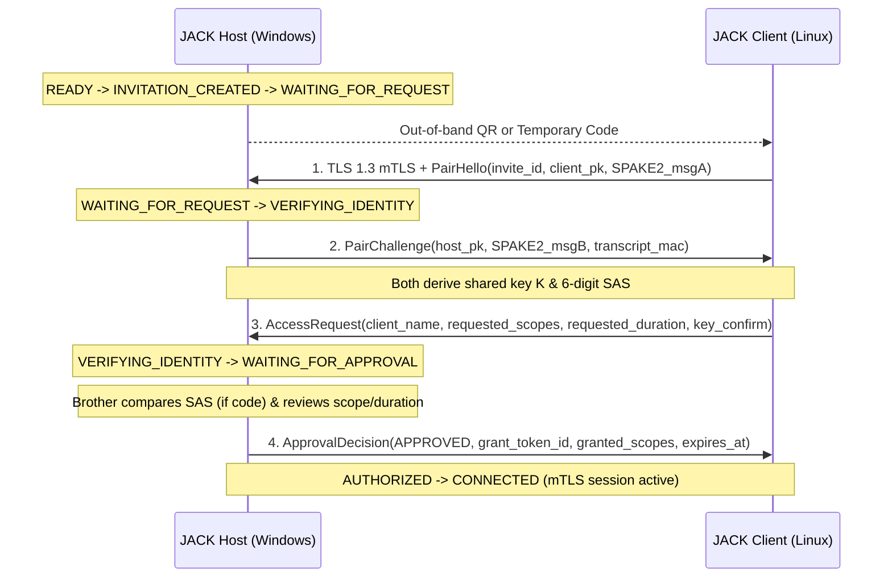
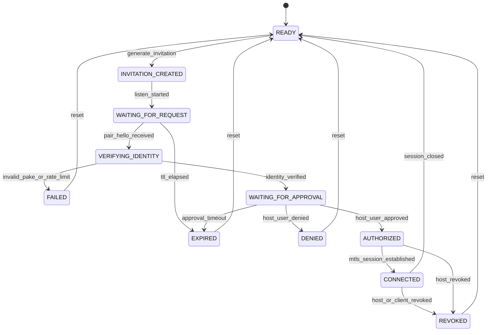

# JACK Easy Pairing — Pairing Protocol, QR/Code & State Machine (`JACK-EP-001`)

> **Classification:** `PROPOSAL` (`NO IMPLEMENTATION` in EP-001)

## 1. QR & Temporary Code Design (G4)

### 1.1 QR Invitation Payload
- **Encoding:** `jack://pair?v=1&id=<invite_id>&pk=<host_ed25519_b64url>&ep=<endpoints_b64url>&exp=<unix_exp>&pake=<128bit_nonce_b64url>`
- **Properties:**
  - **No permanent secrets** embedded (`pk` is the Host's *public* Ed25519 key; `pake` is an ephemeral 128-bit single-use pairing secret).
  - **Expiration:** 300 seconds (5 minutes) default TTL.
  - **Single-Use:** Consumed immediately upon completion or 3 failed verifications; Host deletes the invitation secret from memory on transition to `AUTHORIZED`, `DENIED`, `EXPIRED`, or `FAILED`.
  - **Identity Binding:** The Client pins `pk` from the QR directly when verifying the Host's TLS 1.3 mTLS certificate and SPAKE2 transcript.

### 1.2 Temporary Pairing Code & Six-Digit Security Analysis (`FACT` / `PROPOSAL`)
- **Is a 6-digit code sufficient alone?**
  - **No, if used as a bearer token or offline-crackable secret:** 6 decimal digits have only $10^6$ combinations ($\approx 20$ bits of entropy).
  - **Yes, when paired with SPAKE2 + strict online rate limiting + 6-digit SAS comparison:**
    - Use an **8-character Crockford Base32** human-friendly code (`ABCD-EFGH`, 40 bits) OR a **6-digit code** strictly bound to **SPAKE2** (one online guess per TLS-protected attempt, **max 5 attempts per invitation**, exponential backoff, hard lock after 5 failures -> `FAILED`).
    - **Recommendation:** Use an **8-character Base32 code** (`XXXX-XXXX`, e.g., `7K9M-2P4Q`) for cross-network/LAN entry (40 bits, still easy to type) AND require **both users to compare a 6-digit Short Authentication String (SAS)** derived from `HKDF-SHA256(spake2_shared_key || host_pk || client_pk || invite_id)` during the code flow!
    - For QR flow (where the QR already carries the 128-bit `pake` secret + `host_pk`), the Host still displays the Client's device name and `Device ID` short fingerprint for explicit human approval.
  - **No TOTP:** TOTP requires shared long-lived secrets and clock sync; it is NOT used.
  - **Cross-network code resolution:** On LAN/Tailscale, the code includes or resolves via mDNS/Tailscale peer table (`_jack-pair._tcp.local` or Tailnet peer scan); cross-NAT without Tailscale/LAN requires a future Coordination Service (`EP-006`).

## 2. Protocol Message Sequence

## 3. State Machine (G10)

Required states: `READY`, `INVITATION_CREATED`, `WAITING_FOR_REQUEST`, `VERIFYING_IDENTITY`, `WAITING_FOR_APPROVAL`, `AUTHORIZED`, `CONNECTED`, `DENIED`, `EXPIRED`, `FAILED`, `REVOKED`.

### Valid & Invalid Transitions
- **Valid:** Only forward transitions shown above; terminal outcomes (`DENIED`, `EXPIRED`, `FAILED`, `REVOKED`) must explicitly reset to `READY` (clearing ephemeral invitation secrets) before a new invitation can be created.
- **Invalid (Strictly Rejected):**
  - `WAITING_FOR_REQUEST -> AUTHORIZED` or `CONNECTED` (cannot bypass `VERIFYING_IDENTITY` and `WAITING_FOR_APPROVAL`).
  - `EXPIRED / DENIED / FAILED / REVOKED -> AUTHORIZED` or `CONNECTED` (no resurrection of terminated invitations/trust).
  - `READY -> CONNECTED` without an active `AUTHORIZED` grant and `Device Trust` entry.
