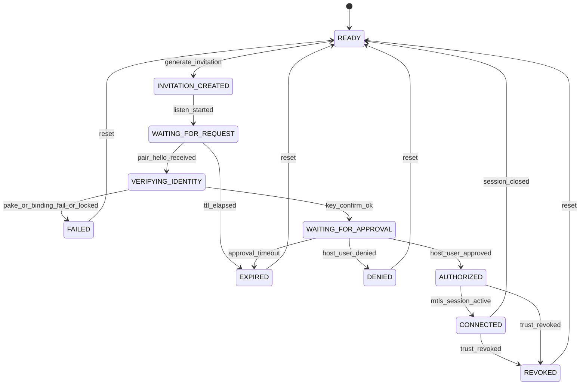

# JACK Easy Pairing — Pairing Protocol, QR/Code & State Machine (`JACK-EP-001A`)

> **Classification:** `PROPOSAL` (Provisional cryptographic design; requires external cryptographic expert review before production qualification. No implementation in EP-001A.)

## 1. Cryptographic Composition & Channel Binding (G1)

### 1.1 Roles, Keys & Trust Anchors
- **Host (`Responder`) & Client (`Initiator`):** Each holds a per-installation **Ed25519** identity keypair (`ed25519-dalek`), represented in TLS 1.3 by a self-signed X.509 certificate wrapping that Ed25519 public key (`rcgen` / `x509-parser`).
- **No Public CA Trust Anchor:** Peers never trust system/WebPKI CAs for JACK pairing or sessions. Post-pairing sessions pin the peer's exact Ed25519 SPKI (`Device ID`).
- **Reviewed Libraries (Provisional Selection):** `rustls` (TLS 1.3), `ed25519-dalek`, `spake2`, `hkdf`, `hmac`, `sha2`, `zeroize`. No custom cryptographic primitives.

### 1.2 PAKE <-> TLS 1.3 Channel Binding & Downgrade Prevention
To prevent PAKE-over-TLS relay/MITM and cross-protocol downgrade attacks:
1. Client and Host establish a **TLS 1.3-only** connection (`rustls` configured with TLS 1.3 only, ALPN `"jack-pair/1"`). Pre-trust pairing verifier extracts the peer's presented certificate Ed25519 public key (`host_pk`, `client_pk`) without persisting trust yet.
2. Both endpoints export the **RFC 9266** channel binding token:
   `tls_cb = tls_exporter("EXPORTER-Channel-Binding", b"", 32)`
3. Both construct the domain-separated binding transcript:
   `transcript = "jack-pair-v1" || invite_id || host_pk || client_pk || tls_cb`
4. Both execute **SPAKE2** using the invitation's pairing secret (`pake_secret` from QR or normalized code), yielding `spake2_key`.
5. Both derive confirmation and SAS material via **HKDF-SHA256**:
   - `confirm_key = HKDF-SHA256(ikm = spake2_key, salt = tls_cb, info = "jack-pair-v1-confirm" || transcript)`
   - `sas_6digit = HKDF-SHA256(ikm = spake2_key, salt = tls_cb, info = "jack-pair-v1-sas" || transcript)` (truncated mod $10^6$, formatted `000 000`)
6. Both exchange explicit **HMAC-SHA256** key-confirmation tags (`"client-confirm"` and `"host-confirm"` over `transcript`) before entering `WAITING_FOR_APPROVAL`.
7. **Downgrade Prevention:** Version `v=1`, ALPN `"jack-pair/1"`, and `"jack-pair-v1"` domain strings are inside the MACed `transcript`. Any version or ALPN mismatch aborts the handshake (`ERR_PROTOCOL_VERSION`).

> **Audit Note (`DECISION_REQUIRED` / `NOT_TESTED`):** While `rustls` + `RFC 9266` + `spake2` + `HKDF-SHA256` uses standard reviewed primitives, this composition is **provisional** and requires an **external cryptographic audit** prior to production qualification.

## 2. QR Invitation Contract (G2)

- **Payload Format:** `jack://pair?v=1&id=<invite_id>&pk=<host_pk_b64url>&ep=<endpoints_b64url>&exp=<unix_exp>&pake=<128bit_secret_b64url>`
- **Honesty Correction (No Permanent Secrets vs Ephemeral Secret):** The `pake` field IS an **ephemeral, single-use 128-bit pairing secret** (not a long-term key, but still a sensitive bearer capability for SPAKE2).
- **Confidentiality & Logging:**
  - `jack://pair?...` URIs and `pake` values must **never** be written to logs, crash reports, analytics, clipboard history warnings, or disk.
  - Ephemeral secrets are held in `Zeroize`-wrapped memory and zeroized immediately on consumption, expiry, failure, or cancellation.
- **Size & Parsing Limits:** Max URI length `1024` bytes; strict `v=1` check; reject unknown critical fields or invalid Base64url; reject expired `exp` (`<= 300s` TTL).
- **If Photographed / Intercepted:** An attacker who scans the QR first still cannot bypass **Host human approval** (`WAITING_FOR_APPROVAL`), which displays the requesting Client's name and cryptographic `Device ID`. Single-use consumption ensures a second scan fails with `ERR_INVITE_CONSUMED`.

## 3. Temporary Pairing Code Contract (G3)

- **Code-First MVP Format:** 8-character **Crockford Base32** (`XXXX-XXXX`, 40 bits of entropy, alphabet `0123456789ABCDEFGHJKMNPQRSTVWXYZ`), case-insensitive, stripping hyphens/spaces and mapping `O->0`, `I/L->1`.
- **Not a Standalone Bearer Credential:** The code alone cannot authorize access. It seeds SPAKE2 (`pake_secret`), which is bound to `tls_cb` + both Ed25519 keys, followed by mandatory **6-digit SAS comparison** and **Host human approval**.
- **Expiry, Attempts & Rate Limiting:**
  - **TTL:** 300 seconds (5 minutes) max.
  - **Max Attempts:** **5** failed SPAKE2/MAC verifications per invitation -> hard lock (`FAILED`), invitation destroyed.
  - **Concurrency:** At most **1** active pairing handshake per invitation (`active_attempt_lock`); concurrent attempts receive `ERR_PAIRING_BUSY`.
  - **Cancellation:** Host **Cancel** immediately transitions to `READY` and zeroizes the invitation.
- **Code Resolution & Cross-Network Limitations:**
  - Client discovers candidate JACK Host endpoints on **LAN** (`_jack-pair._tcp.local` advertising `invite_id` prefix only, never the code) or **Tailnet** (`tailscale status --json` peers).
  - If two devices are on separate NATs without Tailscale or LAN, code resolution **cannot** succeed without the deferred `EP-006` Coordination Service (`ERR_HOST_UNREACHABLE`).

## 4. State Machine & Transitions (G9 / G10)

- **Invalid Transitions (Strictly Rejected):** Any skip of `VERIFYING_IDENTITY` or `WAITING_FOR_APPROVAL`; any transition out of `DENIED`/`EXPIRED`/`FAILED`/`REVOKED` to `AUTHORIZED`/`CONNECTED`; any concurrent `VERIFYING_IDENTITY` while `active_attempt_lock` is held.
